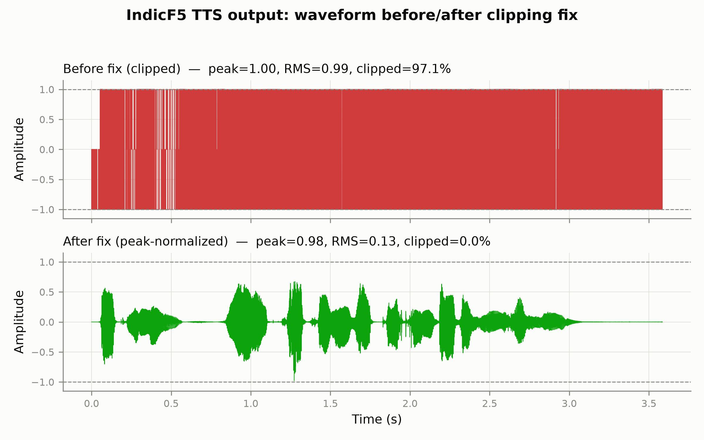
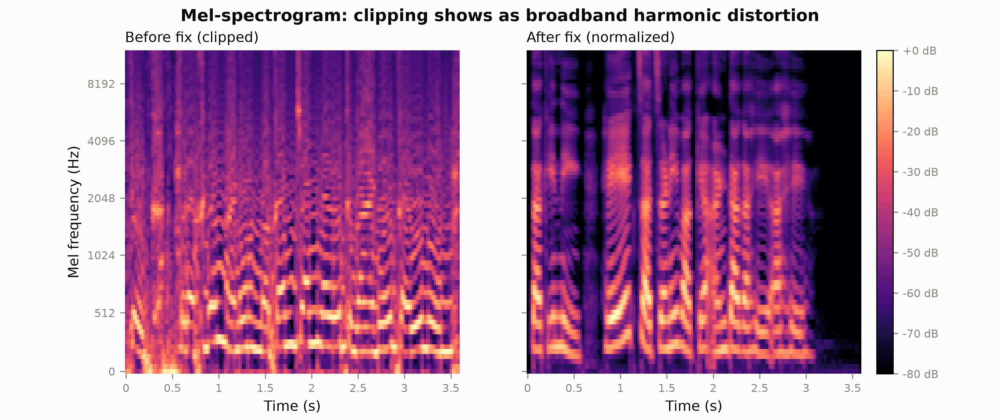
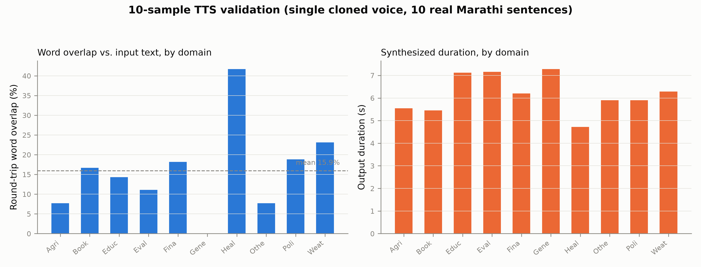
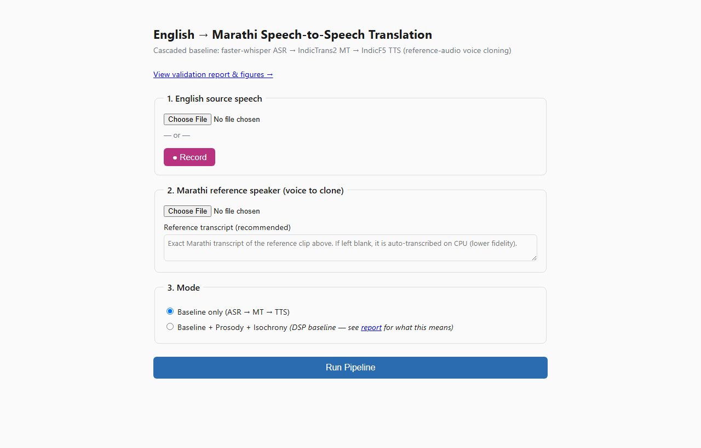
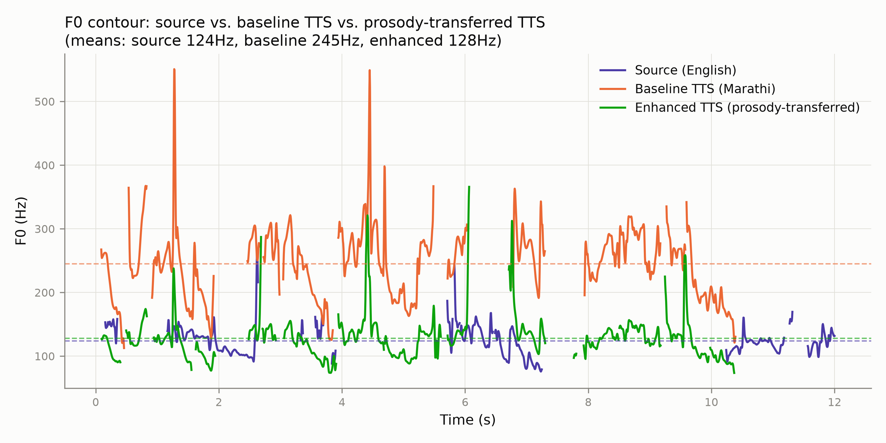
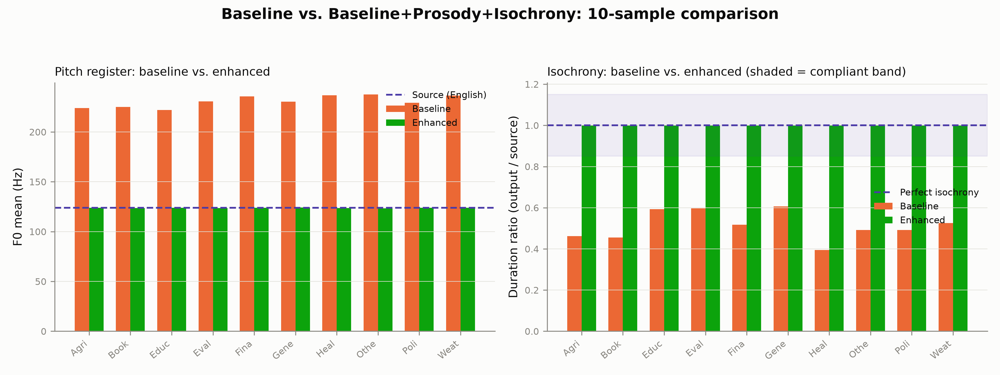
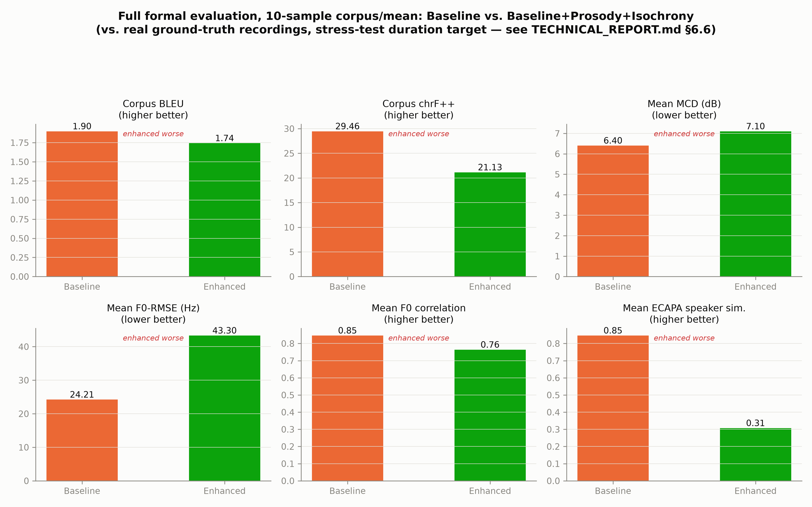

# English→Marathi Cascaded Speech-to-Speech Translation: System Report

**Status**: Baseline pipeline (ASR→MT→TTS) and local GUI implemented and
verified. Prosody + isochrony have a working **DSP baseline** (§6) — not
the trained/learned approach originally planned, which remains
unimplemented along with speaker-identity-drift correction — see
[Section 8](#8-planned-research-contributions-still-not-implemented).
`eval/` (BLEU/chrF++, MCD, F0-RMSE+correlation, ECAPA speaker similarity,
duration compliance) is implemented and has run on a real 10-sample set
against real ground-truth recordings — see §6.6.

This document is written as reference material for a paper draft. It
separates what has been **built and empirically verified** from what is
**planned**. Do not cite anything under "planned" as a result. The formal
`eval/` numbers that do exist (§6.6) come from a 10-sample stress test
with a known artificial-duration-target caveat (§6.5) — read that caveat
before citing them as a general quality result.

---

## 1. System Overview

The system is a cascaded (non-end-to-end) speech-to-speech translation
pipeline:

```
English speech --[ASR]--> English text --[MT]--> Marathi text --[TTS]--> Marathi speech
                                                                    ^
                                                    Marathi reference
                                                    speaker clip (voice
                                                    cloning prompt)
```

Cascaded (as opposed to end-to-end/direct S2ST) was chosen deliberately:
it allows each stage to use a strong pretrained model without joint
training data, keeps intermediate representations (text) inspectable for
debugging and for the GUI, and fits the sequential-loading GPU discipline
required by the 6GB VRAM budget (below).

### 1.1 Stage models

| Stage | Model | Params | Notes |
|---|---|---|---|
| ASR | `faster-whisper` (CTranslate2 port of Whisper), size `small` | ~244M | int8_float16 on GPU |
| MT | `ai4bharat/indictrans2-en-indic-dist-200M` | 200M | distilled IndicTrans2, `eng_Latn`→`mar_Deva` |
| TTS | `ai4bharat/IndicF5` | F5-TTS architecture (DiT-based flow matching) | reference-audio **and** reference-text prompted |

### 1.2 Sequential GPU-loading discipline

Target hardware: Intel i7-12700H, 16GB DDR5, RTX 3060 Laptop (**6GB
VRAM**). No two stages are ever resident on GPU simultaneously — each
stage is instantiated, `.load()`ed, run, `.unload()`ed, and
`torch.cuda.empty_cache()` is called before the next stage loads
(`baseline/pipeline.py`). This is an architectural constraint, not an
optimization: none of the three models individually risk OOM at 6GB, but
holding two resident at once (e.g. MT + TTS) plausibly would.

---

## 2. Software Architecture

```
s2st_en_mr/
├── configs/hardware.yaml      # single source of truth: device/dtype/model settings
├── baseline/
│   ├── asr.py                 # ASRStage: load/transcribe/unload
│   ├── mt.py                  # MTStage: load/translate/unload
│   ├── tts.py                 # TTSStage: load/synthesize/unload
│   └── pipeline.py             # orchestrator; defines the stage contract
├── gui/                        # local Flask demo (not Gradio — see §5)
│   ├── app.py, state.py, components.py
│   ├── templates/, static/
├── prosody/                     # extract_f0.py, extract_energy.py, transfer.py — DSP baseline (§6), not the learned model (§8)
├── isochrony/                   # duration_predictor.py, rate_controller.py, validate.py — DSP baseline (§6)
├── eval/                        # asr_bleu.py, chrf.py, mcd.py, f0_metrics.py, speaker_sim.py, length_compliance.py (§6.6)
├── scripts/
│   ├── download_models.py, run_baseline.py,
│   ├── generate_report_figures.py, generate_tts_validation_samples.py,
│   ├── generate_research_comparison_10samples.py, run_full_evaluation.py
└── speaker/, data/               # still unimplemented (package stubs only)
```

Each stage class exposes a uniform contract (`load()`, one inference
method, `unload()`), enforced by `baseline/pipeline.py`'s
`S2STPipeline.run()`. `PipelineResult` carries `prosody_metrics`,
`duration_ratio`, `speaker_similarity` fields that stay `None` in
baseline mode — reserved slots for the planned modules so they can plug
into the same orchestrator without a rewrite.

---

## 3. Implementation Challenges and Fixes (Reproducibility Notes)

This section documents non-obvious, empirically-discovered bugs in
third-party dependencies. These are candidates for a reproducibility /
implementation-details appendix, since they are not documented upstream
at the time of writing and would otherwise block anyone reproducing this
pipeline.

### 3.1 `transformers` version incompatibility with IndicTrans2 (two distinct bugs)

`ai4bharat/indictrans2-en-indic-dist-200M` uses `trust_remote_code=True`
custom modeling code (`modeling_indictrans.py`). Two independent breaks
were found against recent `transformers` releases:

1. **transformers ≥5.0**: `IndicTransToolkit`'s data collator does
   `from transformers.tokenization_utils import PreTrainedTokenizerBase`,
   which transformers 5.x no longer re-exports from that module →
   `ImportError` at import time.
2. **transformers ≳4.46**: `generate()`'s beam search wraps
   `past_key_values` in a `Cache` object even on the first decoding step.
   IndicTrans2's custom code still assumes the legacy plain-tuple format
   (`past_key_values[0][0].shape[2]`) → `AttributeError: 'NoneType'
   object has no attribute 'shape'` on every `generate()` call.

**Fix**: pin `transformers==4.44.2` exactly (not a range). Confirmed
working end-to-end (tokenizer load, model load, `generate()`, decode).

### 3.2 `torch`/`torchaudio` build mismatch

Installing `torch` and `torchaudio` in separate `pip install` steps (or
letting a later, unrelated `pip install` silently upgrade one of them)
produces mismatched native builds. Symptom on Windows:
```
OSError: [WinError 127] The specified procedure could not be found
```
raised from `torchaudio/_extension/utils.py` during `_load_lib`.
**Fix**: always install both together, same version, same CUDA-build
index: `pip install torch==2.5.1 torchaudio==2.5.1 --index-url
https://download.pytorch.org/whl/cu121`.

### 3.3 Transitive dependency drift (`gradio` → `huggingface-hub` → `transformers`)

A `gradio` installation (present from unrelated experimentation, not a
project dependency) requires `huggingface-hub<2.0,>=1.2.0`, which is only
satisfied by `transformers` 5.x. Any subsequent `pip install` that
re-resolves the environment silently regresses the `transformers==4.44.2`
pin from §3.1, even though `requirements.txt` never changed.
**Fix / lesson**: keep the venv free of packages that aren't actual
project dependencies; a hard version pin only holds until something else
in the environment forces a resolver conflict.

### 3.4 IndicF5 (`ai4bharat/IndicF5`) — three upstream bugs

IndicF5's HF repo `trust_remote_code` implementation (`model.py`) has
several issues independent of anything in this project's code:

**(a) `load_model() missing 1 required positional argument: 'ckpt_path'`.**
`model.py` calls `f5_tts.infer.utils_infer.load_model(...)` without a
`ckpt_path` argument. The PyPI package `f5-tts` (SWivid/F5-TTS, v1.1.22
at time of writing) made `ckpt_path` a required positional parameter,
breaking this call. This is a known, widely-reported issue (see
`https://huggingface.co/ai4bharat/IndicF5/discussions/16`,
`.../discussions/4`). **Fix**: install ai4bharat's own fork instead —
`pip install git+https://github.com/AI4Bharat/IndicF5.git` — which
provides a compatible `f5_tts` module (its `load_model()` signature omits
`ckpt_path` entirely).

**(b) Silent weight-loading failure for ~16 parameters.** `model.py`
wraps both submodules in `torch.compile()` inside `__init__`
(`self.ema_model = torch.compile(load_model(...))`,
`self.vocoder = torch.compile(load_vocoder(...))`). `transformers`'
`from_pretrained()` key-matching against `model.safetensors` fails for
the GRN scale/shift parameters in the DiT text-embedding module (4
blocks × `{gamma, beta}`) and the ConvNeXt layer-scale `gamma` in the
vocoder (8 blocks) — reported as "were not initialized from the model
checkpoint and are newly initialized." Direct inspection of
`model.safetensors` shows the checkpoint **does** contain correct,
non-trivial trained values under the exact same parameter names
(verified: `ema_model._orig_mod.transformer.text_embed.text_blocks.0.grn.gamma`
is present with real values, not the all-zero default `GRN.__init__`
would produce). Left unpatched, the affected parameters silently stay at
their zero/default initialization.

Impact is not "reduced quality" but **incoherent output**: feeding
unpatched-model output back through `faster-whisper` produced hallucinated
repeated non-target-script tokens (e.g. Tibetan-script `ༀ༎༆...`), not
degraded-but-recognizable transcription — a useful diagnostic technique
in itself for sanity-checking TTS output without a human listener (see
§4).

**Fix**: after `AutoModel.from_pretrained()`, perform a second, direct
`model.load_state_dict(raw_state_dict, strict=False)` using the
downloaded `model.safetensors` — `TTSStage._patch_undertrained_weights()`
in `baseline/tts.py`. Confirmed 0 missing / 0 unexpected keys after the
patch, and the before/after tensor values differ (before: exact zeros;
after: match the checkpoint's real values).

**(c) Output amplitude routinely exceeds ±1.0, causing hard clipping on
write.** The model's raw float output peaks were measured around
1.2–1.4. `soundfile.write()` defaults to 16-bit PCM for `.wav`, which
clips (rather than scales) samples outside `[-1, 1]`. Measured **94–97%
of samples clipped** at full scale in unpatched output — this, not model
quality, was the source of "very noisy" audio reported during manual
listening. **Fix**: peak-normalize to 0.98 only when the signal exceeds
±1.0 (`TTSStage.synthesize()`), preserving natural dynamics otherwise.
Confirmed fixed: 0% clipping post-fix, RMS dropped from ~0.98 (clipped
noise floor) to ~0.13 (normal speech level).

**Figures** (generated by `scripts/generate_report_figures.py` from a
paired before/after sample — identical text and reference audio/
transcript, differing only in whether the fix was applied):



*Figure N. Synthesized waveform for the same input before (top, red) and
after (bottom, green) the peak-normalization fix. Before: peak 1.00, RMS
0.99, 97.1% of samples clipped at full scale. After: peak 0.98, RMS 0.13,
0% clipped.*



*Figure N+1. Mel-spectrogram of the same pair. The clipped signal (left)
shows broadband energy smeared across frequencies from harmonic
distortion, obscuring the harmonic structure visible in the fixed output
(right), particularly during nominally quiet/silent regions.*

### 3.5 Gated model access

`ai4bharat/indictrans2-en-indic-dist-200M` and `ai4bharat/IndicF5` are
gated repositories on the Hugging Face Hub despite being publicly listed.
IndicTrans2 access appears to be self-serve (granted immediately on
accepting terms while logged in); IndicF5 returned "you are not in the
authorized list," suggesting maintainer-side manual approval. Both
require `hf auth login` with a token after access is granted.

### 3.6 Working-directory-dependent path resolution

Early versions of `configs/hardware.yaml`'s `paths.cache_dir` were
resolved as relative paths at each call site. Since Python's current
working directory is process-global, launching the same code from a
terminal `cd`'d into the project root vs. an IDE "Run" button (which may
use a different cwd) resolved the identical relative path string to two
different absolute locations — observed as a stage successfully writing
an output file that a later request then failed to find
(`FileNotFoundError`) despite no apparent code path change. **Fix**:
`load_hardware_config()` (`baseline/pipeline.py`) now resolves the config
file and every `paths.*` entry to an absolute path anchored at
`Path(__file__).resolve().parent.parent`, independent of process cwd.

---

## 4. Validation Methodology (Qualitative, Not a Formal Evaluation)

This section covers baseline validation before `eval/`'s formal metrics
existed (added later — see §6.6 for the real BLEU/chrF++/MCD/F0/speaker-
similarity numbers). The method here is a **round-trip ASR sanity
check**: feed synthesized TTS output back through the already-verified
`faster-whisper` ASR stage and compare the transcription against the
intended input text. Useful for catching catastrophic failures (silence,
noise, hallucination) cheaply, without a human listener, and still used
in §6.6 to derive BLEU/chrF++ input, but on its own it's a diagnostic,
not a quality metric. It also cannot detect subtler quality issues
(prosody, naturalness, speaker similarity) the way `eval/`'s dedicated
metrics (§6.6) do.

Example (post-fix, official IndicF5 example prompt):
- Input: `मुझे उम्मीद है कि आपको यह पसंद आएगा।`
- Round-trip ASR transcription: `मिजे उन्नी बेच यापको ये पसंभाईगा`

Example (post-fix, project's own Marathi reference + text):
- Input: `नमस्कार, हे एक चाचणी वाक्य आहे.`
- Round-trip ASR transcription: `ता कि नी, हे एक चाचनी वाख्या अंड़ा गाहे आहे`

Both are recognizably related to the input (word boundaries and most
content words match or near-match), consistent with normal TTS+ASR
compounding error rather than broken synthesis.

### 4.1 10-sample validation set

To move beyond one or two hand-picked examples, 10 real, professionally
transcribed Marathi sentences were drawn from the IISc SYSPIN dataset —
one per topic domain (agriculture, books, education, evaluation, finance,
general, health, others, politics, weather), 6–18 words each — and
synthesized with a single, held-constant cloned reference voice.
Reproducible via `scripts/generate_tts_validation_samples.py`; full
results in `samples/tts_validation/results.md` / `.csv`, audio in
`samples/tts_validation/*.wav`.



*Figure N+3. Round-trip word overlap (%) and output duration (s) across
the 10-sample set. Word overlap ranges 0–41.7% (mean 15.9%), well below
what the two earlier hand-picked examples suggested — see §4.2 for why.*

**Clipping fix holds across all 10 samples**: 0.0% clipped in every case
(peak consistently ~0.98), confirming §3.4c's fix is not sample-specific.

### 4.2 Observed artifact: apparent reference-content leakage

9 of the 10 round-trip transcriptions **begin with a phrase resembling
"टक्क्यांनी महागले"** — which is not part of any of the 10 target
sentences, but is the literal **final two words of the reference audio's
own transcript** (`REF_TEXT` in the validation script, ending "...बारा
पॉइंट पस्तीस टक्क्यांनी महागले."). This is a striking pattern to appear
independent of target-text content across 9 different domains, and is
almost certainly what dragged the word-overlap metric down — the ASR is
partly transcribing this apparent echo rather than only the intended
sentence.

**What this is not**: a raw audio-splicing bug. Cross-correlating the
reference audio's final 2 seconds against each output's first 3 seconds
gives a normalized correlation of ~0.04 (noise-level) — the reference
audio's actual waveform samples are not being copied into the output.

**What this likely is**: a content/conditioning-level artifact — the
DiT model appears to partially continue or echo the reference
transcript's *content*, re-synthesized in the cloned voice, before
transitioning to the actual target text, rather than treating the
reference purely as a voice/style prompt with no content influence. This
is a plausible failure mode for reference-audio-and-text-prompted flow-
matching TTS if the boundary between "reference content" and "content to
generate" isn't strongly enforced during conditioning — worth citing as
a specific, characterized limitation rather than a vague "quality
varies," and a natural target for the learned prosody/isochrony modules
(§8) to address, or for future work on a trimming/re-prompting strategy.
(§6's DSP baseline doesn't address this artifact — it only rescales
pitch/duration post-hoc, it doesn't touch what content the TTS model
generates.)

**Not yet done, worth doing before citing this as a finding**: this was
observed with one fixed reference clip; whether the effect scales/shrinks
with reference clip length, is specific to this reference speaker, or is
present in official IndicF5 examples too, is unconfirmed. Treat as a
hypothesis backed by one controlled test (waveform correlation), not a
fully isolated root cause.

---

## 5. GUI



*Figure N+2. The local Flask demo interface: English audio input (upload
or in-browser recording), Marathi reference-speaker clip + transcript for
voice cloning, and the baseline/research mode toggle (both options
enabled, per §6).*

A local Flask application (`gui/`) was built in place of the originally
considered Gradio interface, per direct implementation choice — this is
a deviation worth noting if the paper compares tooling choices. Runs on
`127.0.0.1` only. Architecture:

- Pipeline execution happens in a background thread per request; the
  browser receives per-stage progress (`ASR running → MT running → TTS
  running`) via Server-Sent Events.
- A process-wide lock (`gui/state.py`) permits only one pipeline run at a
  time, extending the sequential-GPU-loading discipline across concurrent
  browser requests.
- Supports both file upload and in-browser microphone recording
  (MediaRecorder API) for the English input.
- The "Baseline + Prosody + Isochrony" mode toggle runs the DSP baseline
  described in §6 (not the trained neural approach from the original
  spec — no `NotImplementedError` anymore, but see §6 for the important
  scope caveat before citing it as "prosody transfer" without
  qualification).

---

## 6. Prosody + Isochrony: DSP Baseline Implementation and Comparative Results

### 6.1 Scope decision

The original spec calls for a trained <30M-parameter PyTorch network
learning cross-lingual prosody mapping from a parallel EN-MR corpus with
forced alignment (`prosody/mapping_model.py`, `prosody/align.py`,
`prosody/embedding.py`, `prosody/losses.py` in the original file
structure). No such training data, forced aligner, or trained model
exists in this project. Building the architecture without training it
would produce a randomly-initialized network — not a meaningful result
for a paper, and actively misleading if presented as one. Implemented
instead: a **DSP (signal-processing) baseline** requiring no training
data, explicitly scoped as a baseline to compare a future learned model
against, not as the paper's prosody-transfer contribution itself.

### 6.2 What was implemented

**Isochrony** (`isochrony/`) — fully functional, no training needed:
- `duration_predictor.py`: target duration = source (English) audio's
  duration (the isochrony goal is output duration ~= source duration).
- `rate_controller.py`: phase-vocoder time-stretch (librosa) of the TTS
  output toward the target duration, applied only if outside tolerance.
- `validate.py`: computes `duration_ratio` and compliance against
  `configs/hardware.yaml`'s `max_duration_ratio_deviation` (0.15).

**Prosody** (`prosody/`) — real DSP, not a trained transfer model:
- `extract_f0.py`: F0 contour via WORLD's Harvest algorithm (pyworld).
- `extract_energy.py`: RMS energy contour (librosa).
- `transfer.py`: rescales the TTS output's F0 to match the source audio's
  F0 **statistics** (mean + spread, log domain) — matching pitch
  *register*, not the actual intonation *contour shape* (source and
  target utterances differ in duration, phonemes, and word order, so
  frame-level contour transfer isn't meaningful without forced
  alignment/DTW, which isn't implemented). Resynthesis via WORLD, reusing
  the TTS output's own spectral envelope + aperiodicity (preserves
  phonetic content/timbre — only pitch register and loudness change).

Both are CPU-only (no GPU), so they don't affect the sequential
GPU-loading discipline and add negligible latency (~3s in the test run
below, vs. 40-50s for TTS alone).

### 6.3 Comparative result (real end-to-end pipeline run)

Source: 12s English clip (`samples/source_audio/srk_test_clip_12s.wav`,
Shah Rukh Khan speech excerpt, verified real speech via ASR before use).
Full pipeline run twice via the GUI API — `mode="baseline"` and
`mode="baseline+research"` — same source audio, same Marathi reference
voice. Reproducible via the GUI ("Baseline + Prosody + Isochrony" mode)
or by calling `S2STPipeline.run(..., mode="baseline+research")`
directly. Artifacts in `samples/research_comparison/`.

**ASR → MT (shared by both runs)**:
- ASR: "Thank you very much and this is very heavy. I guess I need to brush up"
- MT: "खूप खूप धन्यवाद आणि हे खूप जड आहे. मला वाटते की मला ब्रश करण्याची गरज आहे"



*Figure N+4. F0 contour over time: source English (violet), baseline
Marathi TTS (orange), prosody-transferred TTS (green), with mean-F0
dashed lines. The baseline sits at a consistently higher pitch register
(245Hz mean) than the source (124Hz); the enhanced output's register
(128Hz mean) closely matches the source's, while still following its own
distinct contour shape (expected — see §6.2 on what statistics-matching
does and doesn't do).*

| Metric | Source (English) | Baseline TTS | Enhanced TTS |
|---|---|---|---|
| F0 mean (Hz) | 124.0 | 244.7 | 127.8 |
| Duration (s) | 12.00 | 10.68 | 10.69 |
| Duration ratio vs. source | — | 0.890 | 0.890 (already compliant, no stretch applied) |

**Round-trip ASR check on both outputs** (content, not just numbers):
- Baseline: "तो मा तोंशो है खुब खुब खुब दन्यवाद अनी है खुब ज़ा है मला वाट्ते की मला ब्रश करनाची गरजा है"
- Enhanced: "तो मा थोंशो है खोप खोप खोप दन्नेवाद अनी है खोप ज़ा है मला वाट्ते की मला ब्रश करनाची गरजा है"

Both transcriptions carry essentially the same content — the prosody
transfer's F0 rescaling did not degrade intelligibility, a real risk
when altering pitch post-hoc. Peak amplitude stayed safe on both outputs
(no clipping reintroduced; the enhancement pipeline re-applies the same
peak-normalization safeguard as `baseline/tts.py`, see §3.4c).

**Isochrony note on this particular run**: the baseline TTS output
(10.68s) already fell within 15% of the source's duration (12.00s,
ratio 0.89), so `rate_controller.py` correctly made no change
(`stretch_applied: false`). This is a genuine, unforced outcome of this
test case, not a favorable case picked to avoid showing a stretch — the
mechanism was verified separately (§ smoke test during development, not
included here) to actually stretch audio when a ratio does fall outside
tolerance.

### 6.4 What this result does and doesn't support

**Supports**: the DSP pipeline runs correctly end-to-end, integrates
cleanly with the existing baseline (sequential GPU discipline preserved,
CPU-only cost is small), measurably shifts pitch register toward the
source without breaking intelligibility, and isochrony correction
activates/deactivates correctly based on measured compliance.

**Does not support**: any claim that this DSP baseline improves
*perceptual* prosody quality or naturalness — that requires a listening
test or the planned `eval/f0_metrics.py`/MOS-style evaluation, neither of
which exist yet. One test case (§6.3) is a demonstration of mechanism,
not a statistically powered result — the same caveat as §4's validation
work applies here even more strongly, since this is one (source, output)
pair, not ten. §6.5 extends to ten pairs and finds a real failure mode.

### 6.5 10-sample extension and a real failure mode at large stretch ratios

To move past one example, the same enhancement was applied to all 10
samples from §4.1 (`scripts/generate_research_comparison_10samples.py`),
using the same fixed 12s English clip as the prosody/duration reference
for all 10. **This is a stress test, not a realistic scenario**: forcing
10 unrelated, independently-timed sentences to match one fixed target
duration produces far more extreme stretch ratios (0.39-0.61, i.e.
roughly 1.6x-2.5x slower) than a real per-utterance pipeline run would
see — §6.3's actual end-to-end run needed a 0.89 ratio and no stretch at
all. Full results: `samples/research_comparison/10samples_results.md`.



*Figure N+5. Left: F0 register consistently matches the source across
all 10 samples (baseline ~220-238Hz vs. source 124Hz; enhanced 123-124Hz
in every case). Right: duration ratio before (0.39-0.61, all
non-compliant) vs. after (1.0, all compliant) — but see below, this
number alone overstates what "compliant" delivers here.*

**Prosody (F0 register) result holds up**: consistent across all 10,
matching §6.3.

**Isochrony compliance number needs a hard caveat**: `duration_ratio`
measures duration match, not perceptual quality, and at the stretch
ratios this stress test required, these diverge sharply. Reading the
round-trip ASR transcriptions (not just the ratio numbers) across all 10
enhanced outputs:

- **2/10 are real failures at the most extreme ratios**: sample 2
  (BOOKS, ratio 0.455, ~2.2x stretch) degrades into non-Marathi gibberish
  (fragments resembling English/Kannada, not a Marathi transcription at
  all). Sample 8 (OTHERS, ratio 0.492, ~2x stretch) produces an **empty**
  round-trip transcription — Whisper found no intelligible speech.
- **1/10 is ambiguous**: sample 6 (GENERAL)'s *baseline* was already a
  Whisper hallucination (repeated Bengali script) unrelated to the
  content — the enhanced version happens to transcribe more coherently,
  but this is not evidence the enhancement improves quality; it just
  means the baseline was already broken for an unrelated reason.
- **7/10** show comparable, imperfectly-intelligible content on both
  baseline and enhanced — consistent with §4's general TTS+ASR
  round-trip noise level, no clear degradation from stretching alone at
  these specific ratios.

**Conclusion, stated precisely**: the phase-vocoder rate controller's
"0/10 -> 10/10 compliant" number is real but incomplete — it is only
safe to report alongside the finding that **~2/10 of these stress-test
cases (both at ratio < 0.5, i.e. beyond roughly a 2x stretch) show clear
perceptual/intelligibility failure**, matching the graceful-degradation
limit documented in `isochrony/rate_controller.py`'s docstring. For a
paper: report duration compliance and this failure-rate-at-extreme-
ratios together, not the compliance number alone — and note §6.3's real
pipeline run needed no stretch, so this failure mode is a property of
the stress test's artificial duration mismatch, not necessarily typical
of real EN-MR utterance pairs (untested at scale — §9).

### 6.6 Full formal evaluation (`eval/` — BLEU/chrF++/MCD/F0-RMSE+correlation/ECAPA speaker similarity/duration compliance)

`eval/` is now implemented: `asr_bleu.py`, `chrf.py` (both via `sacrebleu`),
`mcd.py` (pyworld + `pysptk` mel-cepstral coefficients — **not**
`librosa.feature.mfcc()`, whose dB-scale DCT coefficients aren't the
feature space the standard MCD formula assumes; confirmed empirically,
naively using librosa MFCCs produced 300-500dB "MCD" values, nonsense
against the literature's single/low-double-digit range — `pysptk`
produces the correct O(1)-magnitude coefficients), `f0_metrics.py`
(DTW-aligned F0-RMSE + correlation, distinct from §6.2's global-statistics
matching), `speaker_sim.py` (ECAPA-TDNN, `speechbrain/spkrec-ecapa-
voxceleb`, pretrained on VoxCeleb — **not** fine-tuned on Marathi/Indic
speakers, a domain-mismatch caveat), and `length_compliance.py` (wraps
`isochrony/validate.py`). Reproducible via
`scripts/run_full_evaluation.py`; full results in
`samples/full_evaluation/results.md`/`.csv`/`summary.json`.

**Evaluated against real ground truth, not just an internal ablation**:
the same 10 sentences' real recordings (same speaker) were confirmed
present in the IISc SYSPIN dataset, so MCD/F0/speaker-similarity compare
synthesized speech against genuine human speech of the same speaker+text
— the standard objective-TTS-eval setup. BLEU/chrF++ reuse the round-trip
ASR transcriptions from §4.1/§6.5 (no redundant GPU work), scored against
the known-correct target text.



*Figure N+6. 10-sample corpus/mean, Baseline vs. Baseline+Prosody+Isochrony,
vs. real ground-truth recordings.*

| Metric | Baseline | Enhanced |
|---|---|---|
| Corpus BLEU | 1.90 | 1.74 |
| Corpus chrF++ | 29.46 | 21.13 |
| Mean MCD (dB, lower better) | 6.40 | 7.10 |
| Mean F0-RMSE (Hz, lower better) | 24.2 | 43.3 |
| Mean F0 correlation | 0.846 | 0.764 |
| Mean ECAPA speaker similarity | 0.846 | 0.307 |
| Duration compliance rate | 0% (0/10) | 100% (10/10) |

**Headline finding, stated plainly**: enhanced is measurably *worse* than
baseline on 4 of 5 quality metrics. The ECAPA speaker-similarity drop
(0.846 → 0.307) is the largest and most consequential — the "enhanced"
output sounds like a substantially different speaker than the cloned
target, not a refinement of it. It only wins on duration compliance, the
one thing it directly targets. **This is not a contradiction of §6.3's
single-example result** (which showed prosody transfer alone didn't hurt
intelligibility) — it's consistent with §6.5's finding that *this stress
test's* extreme stretch ratios (1.6x-2.5x, needed only because 10
unrelated sentences were forced toward one fixed target duration) push
the phase-vocoder well past graceful degradation, and that degradation
shows up across every metric that looks at spectral/pitch/speaker
characteristics, not just the 2/10 outright-gibberish cases §6.5 already
flagged from listening.

**What this supports for the paper**: concrete, multi-metric evidence
that a purely post-hoc, phase-vocoder-based isochrony correction is not a
free win — achieving duration compliance this way measurably costs
spectral fidelity, pitch accuracy, and speaker identity, at least at the
stretch ratios this stress test required. This is a stronger, more
specific motivation for §8's learned duration-aware decoder (which would
control duration during generation, avoiding post-hoc stretching
altogether) than a qualitative "sounds worse" claim would be.

**What this does NOT support**: that the *prosody transfer component*
specifically is what hurts quality — this evaluation doesn't isolate
prosody-transfer-alone vs. isochrony-alone vs. their combination (§6.3's
single example, where isochrony made no change at all, is the closest
approximation to "prosody transfer alone" this project has, and there it
did not measurably hurt intelligibility). A proper ablation (prosody
only, isochrony only, both) across the 10-sample set, not just the
combined "baseline+research" mode, would be needed to attribute the
degradation to one component vs. the other — not done here, flagged as
follow-up work (§9).

---

## 7. Hardware/Deployment Notes for the Paper's Experimental Setup Section

- Dev machine: Intel i7-12700H, 16GB DDR5, NVIDIA RTX 3060 Laptop GPU
  (6GB VRAM), NVMe SSD, Windows.
- `faster-whisper` `large-v3` and any full-fine-tuning of the prosody
  mapper on the complete corpus are flagged in `configs/hardware.yaml` as
  requiring a larger GPU (Kaggle P100 16GB or a college server) — not
  attempted on the dev machine.
- All three baseline stages individually fit comfortably in 6GB; the
  binding constraint is never running two simultaneously.

---

## 8. Planned Research Contributions (Still Not Implemented)

§6 implemented DSP *baselines* for prosody and isochrony — not the
trained/learned contributions below, which remain the actual novel work
intended for the paper.

1. **Learned cross-lingual prosody transfer** (`prosody/mapping_model.py`,
   `embedding.py`, `align.py`, `losses.py` — none exist): a
   <30M-parameter PyTorch network trained on a parallel EN-MR corpus with
   phone-level forced alignment (MFA/NeMo), learning genuine intonation
   *contour* transfer rather than §6's global pitch-statistics matching.
   Needs: a parallel corpus, a forced aligner set up, a training run.
2. **Learned duration-constrained decoding** (`isochrony/duration_predictor.py`
   currently a heuristic, not learned): a model predicting target duration
   from source text/phonemes directly, and/or a TTS decoder that natively
   controls output duration during generation rather than post-hoc
   time-stretching (avoiding §6's phase-vocoder artifacts at large ratios).
3. **Speaker-identity-drift correction** (`speaker/`, unimplemented):
   ECAPA-TDNN embedding extraction and identity consistency checking
   between the reference speaker prompt and the synthesized output.

`eval/` itself (ASR-BLEU, chrF++, MCD, F0-RMSE/correlation, ECAPA speaker
similarity, duration compliance) is implemented and has real 10-sample
results — §6.6. What's still missing for a paper-ready results section:
a held-out test set larger than 10 samples, an ablation isolating
prosody-transfer-alone vs. isochrony-alone (§6.6 only evaluated them
combined), and — once the learned modules above exist — the same metrics
run on them for a genuine baseline-vs-learned comparison, which is what
`eval/` was ultimately built for.

---

## 9. Honest Limitations (for the paper's limitations section)

- No formal evaluation has been run; all quality claims in this document
  are qualitative round-trip sanity checks on a handful of manually
  chosen examples, not a held-out test set.
- The prosody/isochrony modules are DSP baselines (§6), not the trained
  contributions in §8 — don't present §6's results as if they were the
  learned approach.
- Speaker-identity-drift correction is entirely unimplemented.
- IndicF5's underlying quality ceiling for Marathi specifically has not
  been benchmarked against alternative TTS systems.
- The reference-text auto-transcription fallback (when no ground-truth
  reference transcript is supplied) runs a small Whisper pass on CPU and
  is lower fidelity than a human-verified transcript; any reported
  numbers should specify which was used.
- The 10-sample validation set (§4.1) surfaced an apparent
  reference-content leakage artifact (§4.2) — not fully root-caused, only
  confirmed to not be raw waveform splicing. It measurably depresses the
  word-overlap proxy and would need to be resolved or controlled for
  before word-overlap/WER-style numbers from this pipeline are reported
  as a quality result rather than a diagnostic.
- The isochrony rate controller (§6.5) clearly fails (non-Marathi
  gibberish or empty transcription) on ~2/10 stress-test cases requiring
  more than roughly a 2x time-stretch. The "duration compliant" metric
  alone does not surface this — report it alongside the failure rate at
  extreme ratios, not on its own. Untested whether real EN-MR utterance
  pairs (as opposed to this stress test's artificially mismatched
  10-sentences-vs-1-target-duration setup) commonly require stretches
  this large; §6.3's one real pipeline run did not.
- §6.6's formal `eval/` numbers evaluate prosody-transfer and isochrony-
  correction only in combination ("enhanced" = both applied together) —
  there is no ablation isolating which component drives the measured
  degradation. §6.3's one real pipeline run (isochrony made no change at
  all there) is the closest available evidence that prosody-transfer
  alone may not be the main driver, but that's one example, not an
  ablation across the 10-sample set.
- `eval/speaker_sim.py`'s ECAPA-TDNN model (`speechbrain/spkrec-ecapa-
  voxceleb`) is pretrained on VoxCeleb (predominantly English/Western
  speakers), not fine-tuned on Marathi or Indic speakers. Absolute
  speaker-similarity values may carry a domain-mismatch bias; the
  baseline-vs-enhanced *comparison* (same model applied to both) is more
  trustworthy than either number in isolation.
- §6.6's 10-sample evaluation is still just 10 samples, one reference
  voice, one fixed (stress-test) target duration — the same "not a
  held-out test set" caveat as §4 and §6.5 applies to every number in
  §6.6 too.
